<div align="center">

# ⌖ CODEGATE

**Secure, fair event ticketing, with QR passes that can't be screenshotted, scalped or faked.**

Your pass stays encrypted until one hour before doors open, and resale happens in the open.

### [▶ Try it live: codegate-coral.vercel.app](https://codegate-coral.vercel.app)


-0c0e10?style=for-the-badge&logo=turso&logoColor=c8ff2e)


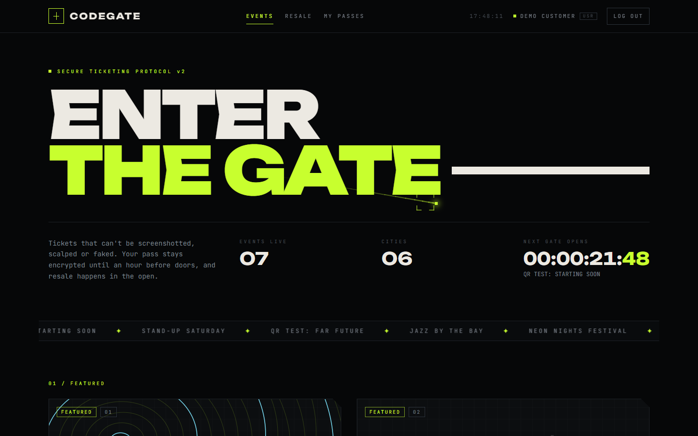

</div>

---

## ✦ What it does

| | For fans | For organizers |
|---|---|---|
| 🎟️ | Browse events, buy a pass in one click | List events with date, venue, price and tags |
| 🔒 | QR code stays **blurred and locked** until 1 hour before doors | See every event you've published in one console |
| 🔁 | Resell a pass you can't use, or buy one from another fan | Cover art is generated automatically for each event |

---

## ⚡ Quick start

**Use it online:** open **[https://codegate-coral.vercel.app](https://codegate-coral.vercel.app)** and log in with a demo account. The login page has one-click buttons for these:

| Role | Email | Password |
|---|---|---|
| 🎧 Customer | `customer@codegate.com` | `password123` |
| 🛠️ Organizer | `organizer@codegate.com` | `password123` |

**Run it on your machine:** you only need **Node.js 22+**. Locally, CodeGate uses a SQLite file that's created and filled with demo data on first run, so there's no database to install.

```bash
git clone https://github.com/harshh-2505/CodeGate.git
cd CodeGate
npm install
npm run dev               # then open the address it prints (port 5173)
```

---

## 🖼️ Tour

### The timed QR pass, CodeGate's flagship feature

Every ticket is a boarding pass. The QR code is blurred with a scan line and a countdown until one hour before the event, then unlocks with **ACCESS GRANTED**.

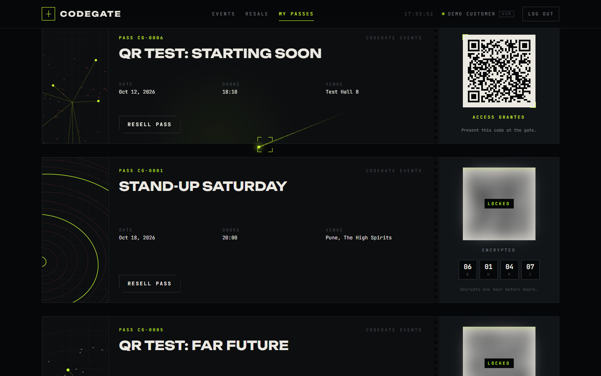

### Departures board

All events in an airport-style board. Hovering a row lights it up and floats that event's cover art next to the cursor.

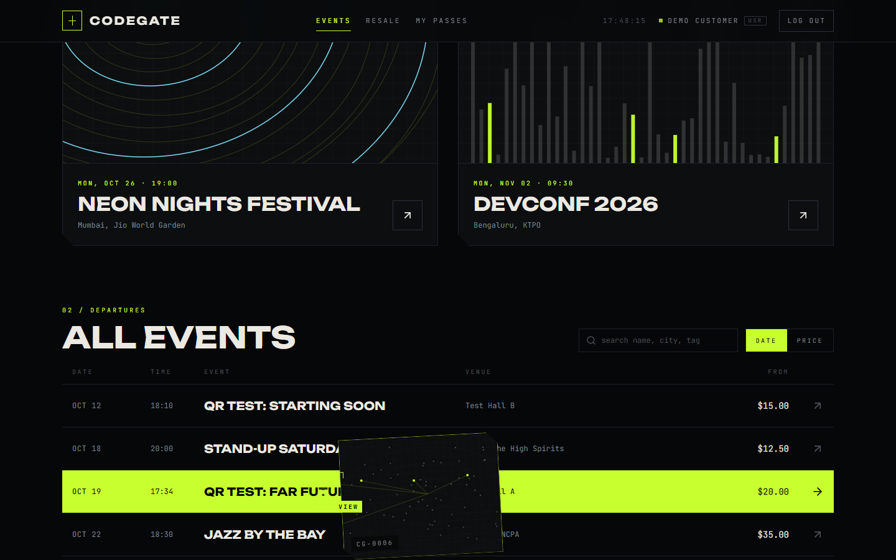

### Event page

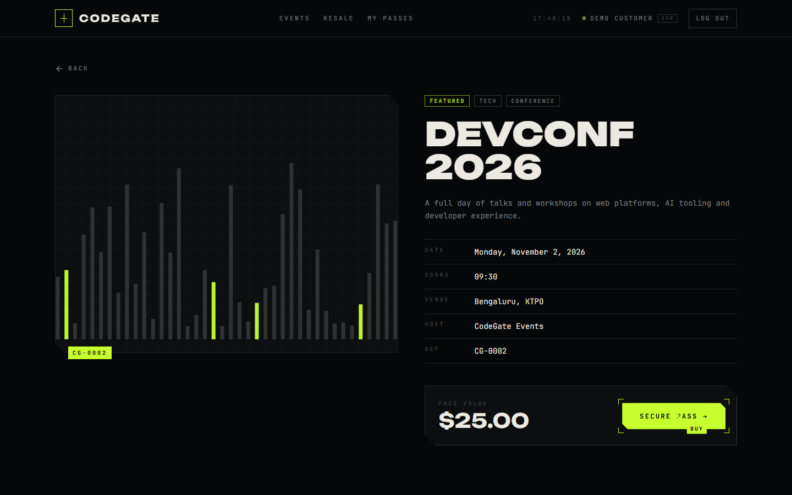

<table>
  <tr>
    <td width="50%"><b>Resale market</b><br/>Shows each price against face value.<br/><br/>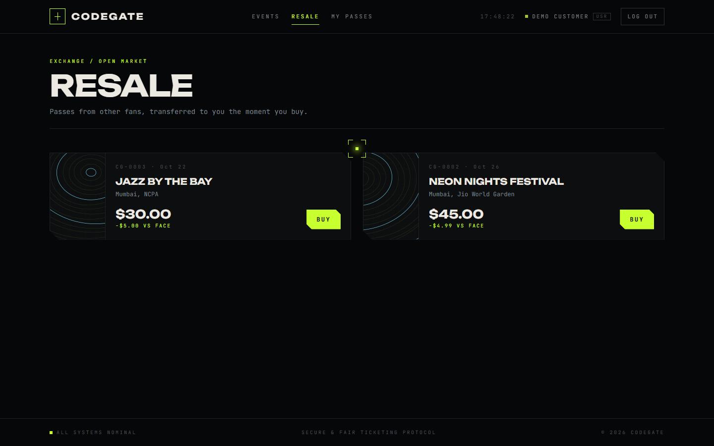</td>
    <td width="50%"><b>Listing a pass for resale</b><br/>Set your price; withdraw any time.<br/><br/>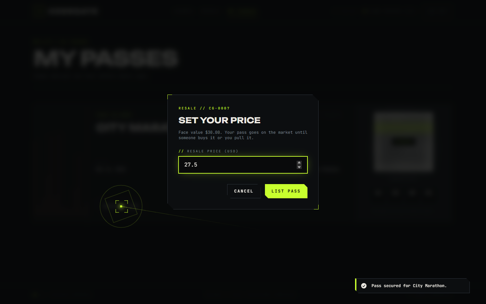</td>
  </tr>
  <tr>
    <td width="50%"><b>Organizer console</b><br/>Your events and quick stats.<br/><br/>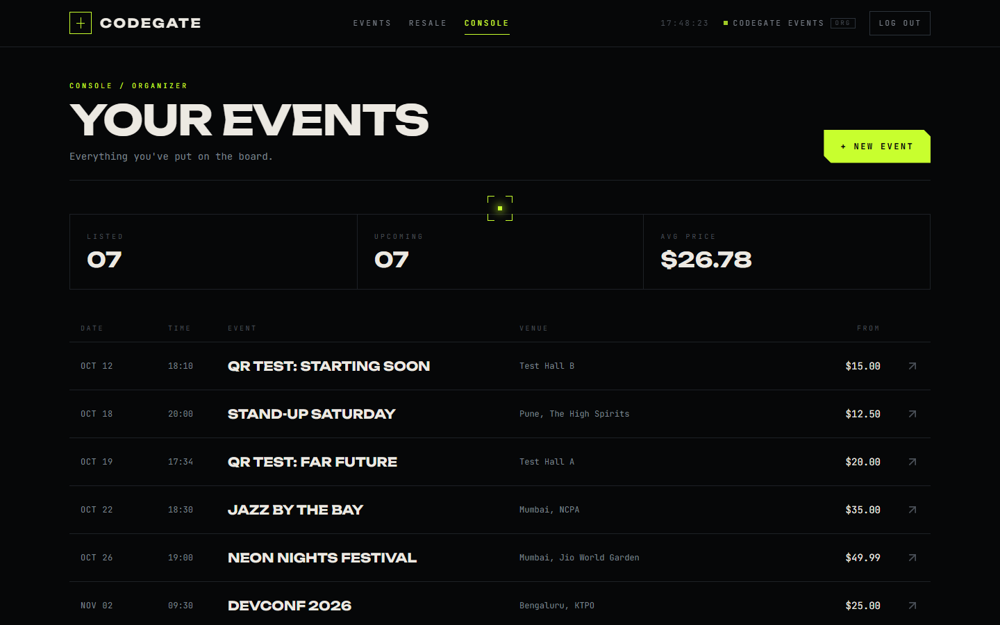</td>
    <td width="50%"><b>Create an event</b><br/>With a live preview card.<br/><br/>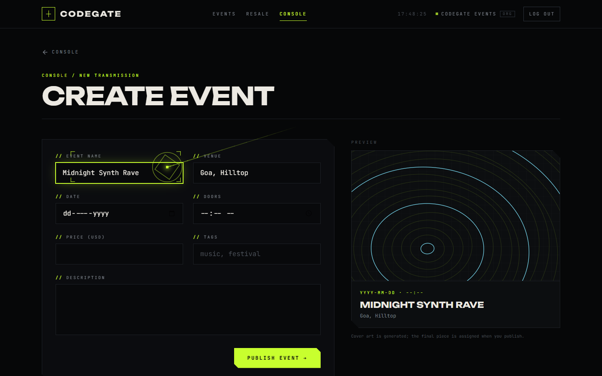</td>
  </tr>
  <tr>
    <td width="50%"><b>Login</b><br/>One-click demo accounts.<br/><br/>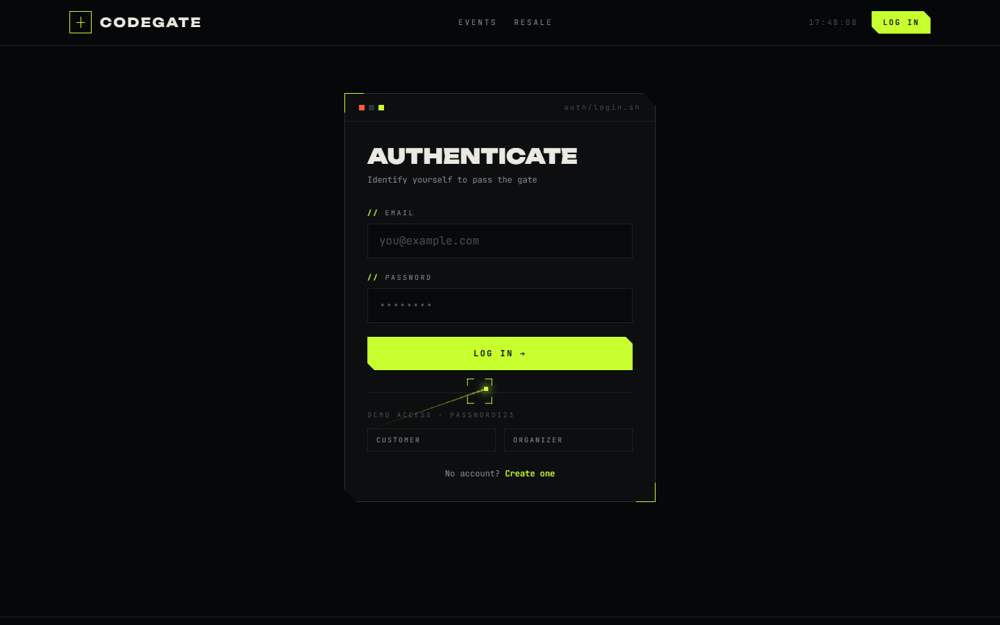</td>
    <td width="50%" align="center"><b>Mobile</b><br/>Works on phones too.<br/><br/>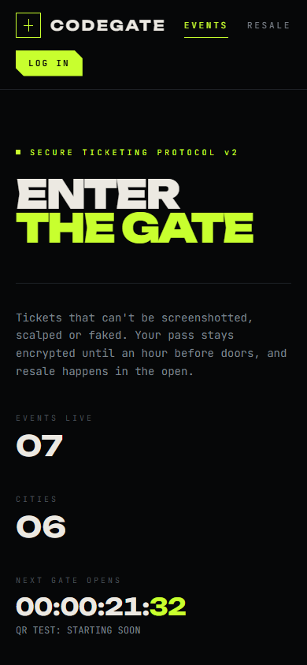</td>
  </tr>
</table>

---

## 🖱️ Cursor effects

The interface reacts to your mouse:

- **Custom cursor:** a glowing dot with a fading lime trail.
- **Snapping frame:** a square frame follows the cursor and locks around buttons and links, with a label like `VIEW`, `BUY` or `SELL`.
- **Click ripple:** clicking sends out a ripple from the cursor.
- **Grid spotlight:** the background grid lights up wherever the cursor is.
- **Tilt and glare:** cards and passes tilt toward the cursor with a moving highlight.
- **Magnetic buttons:** the main buttons are pulled slightly toward the cursor.
- **Text scramble:** headings and menu links decode from random characters.

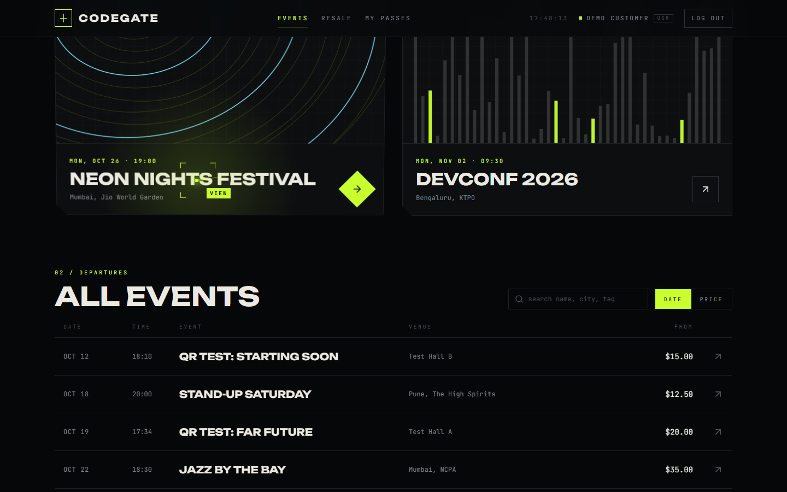

> Touch devices keep the standard cursor. If someone turns on **reduced motion** in their system settings, they get the normal cursor and near-instant animations.

---

## 🧱 How it's built

```
CodeGate/
├── client/                 React 19 + TypeScript + Vite
│   └── src/
│       ├── pages/          one file per screen (auth, home, event, passes, organizer)
│       ├── components/     Layout, EventBoard, TicketCard, UI primitives
│       ├── fx/             cursor + trail, grid spotlight, tilt, magnetic, scramble, cover art
│       ├── hooks/          data fetching and mutations (TanStack Query)
│       └── lib/            API client, types, formatting
├── server/                 Node + Express 5 + TypeScript
│   └── src/
│       ├── routes/         auth, events, tickets, resale
│       ├── db.ts           database client + schema (libSQL / Turso)
│       └── seed.ts         demo data
├── api/index.mjs           Vercel serverless entry (wraps the Express app)
├── vercel.json             Vercel build + routing config
├── docs/screenshots/       the images in this README
└── legacy/                 the original single-file React + PHP version
```

| Layer | Tech |
|---|---|
| UI | React 19, React Router 7, Tailwind CSS v4, Motion, Lucide icons, `qrcode.react` |
| Data | TanStack Query (caching, refetching), a typed fetch client |
| API | Express 5, Zod validation, JWT auth, bcrypt password hashing |
| Storage | libSQL via `@libsql/client`: a local SQLite file in development, a hosted [Turso](https://turso.tech) database in production |

**Security:** the server identifies users from their login token, never from IDs the browser sends. Customers can only resell their own passes, only organizers can create events, and a resale purchase transfers ownership in a single database transaction.

---

## 🛠️ Scripts

| Command | What it does |
|---|---|
| `npm run dev` | Starts the API (port 4000) and the web app (port 5173) with hot reload |
| `npm run build` | Type-checks and builds the server and the client |
| `npm start` | Serves the built app and the API together on port 4000 |
| `npm run seed` | Wipes the database and reloads the demo data |
| `npm run typecheck` | Type-checks everything |

### Deployment

The live site runs on **[Vercel](https://codegate-coral.vercel.app)**:

- `npm run build` builds the React app into `client/dist`, which Vercel serves from its CDN.
- Every `/api/*` request goes to one serverless function (`api/index.mjs`) that runs the Express app.
- Data lives in a **Turso** database connected through the Vercel Marketplace, which provides `TURSO_DATABASE_URL` and `TURSO_AUTH_TOKEN`.
- `JWT_SECRET` is set as a secret environment variable on the project. The server won't start in production without it.

To self-host instead, copy `.env.example` to `.env`, fill it in, then `npm run build && npm start`.

---

## 🔌 API

| Method | Path | Who can call it |
|---|---|---|
| `POST` | `/api/auth/signup` · `/api/auth/login` | anyone |
| `GET` | `/api/auth/me` | logged in |
| `GET` | `/api/events` · `/api/events/:id` | anyone |
| `POST` | `/api/events` | organizers |
| `GET` `POST` | `/api/tickets` | customers (their own passes) |
| `PUT` `DELETE` | `/api/tickets/:id/resale` | the pass owner |
| `GET` | `/api/resale` | anyone |
| `POST` | `/api/resale/:id/buy` | customers |

Logged-in requests send `Authorization: Bearer <token>`.
